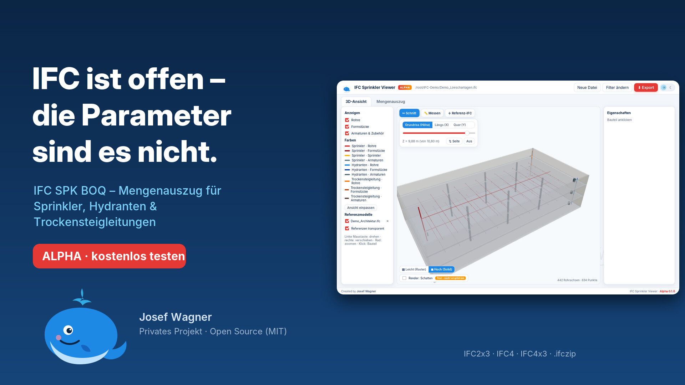
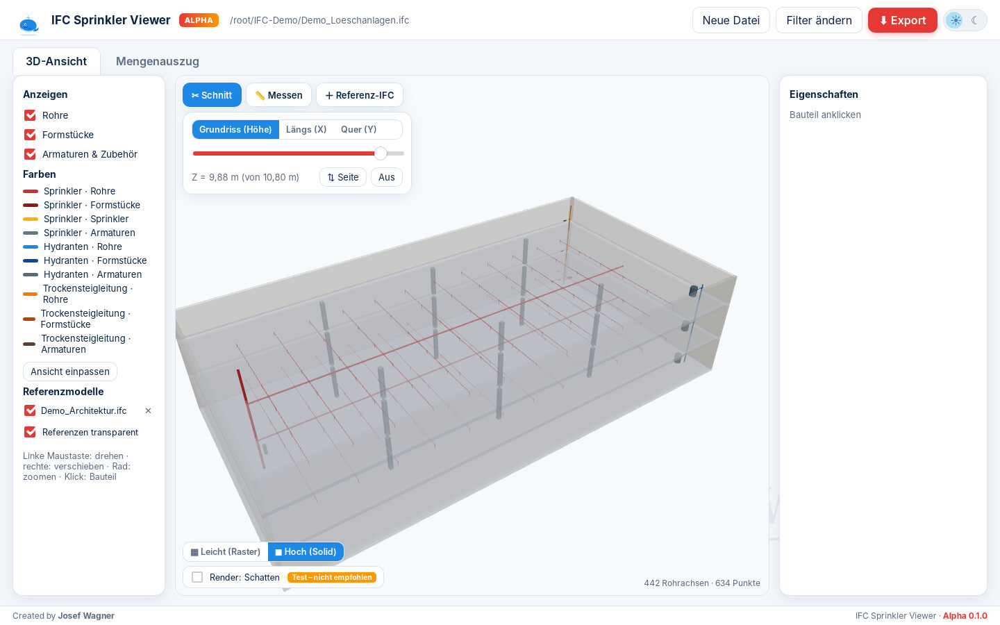
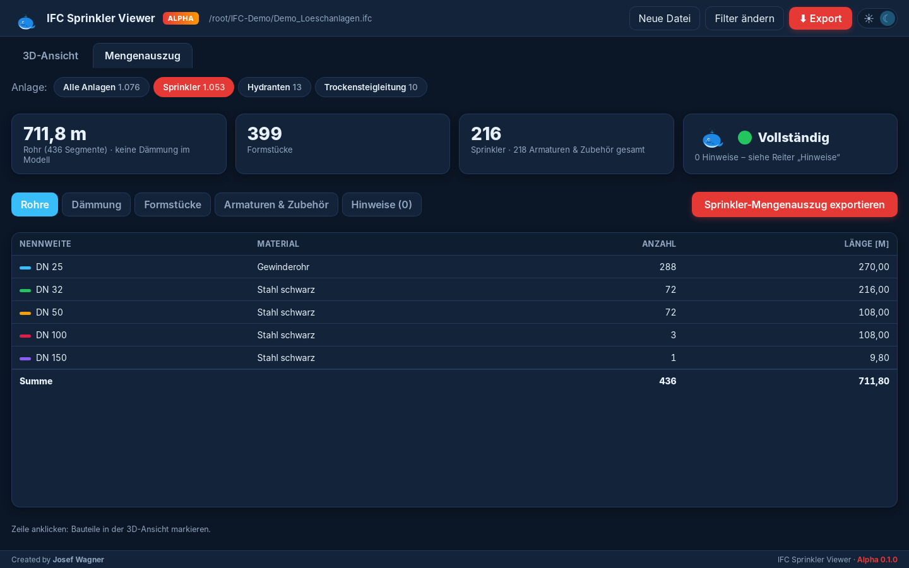

# IFC SPK BOQ – IFC Sprinkler Viewer (ALPHA 0.1.0)

**Created by Josef Wagner**



Desktop-App, die IFC-Modelle von Kunden öffnet, die Löschanlagen herausfiltert, vereinfacht in 3D zeigt und einen Mengenauszug (BOQ) für das Angebot erstellt – getrennt nach **Sprinkler**, **Hydranten** und **Trockensteigleitungen**. Alle Daten bleiben lokal auf dem Rechner.

> ⚠️ **Alpha-Version** – Vorabversion zum Testen. Mengen bitte stichprobenartig gegen das Modell prüfen. Rückmeldungen gern an Josef Wagner.

## Download (Testversion)

| System | Datei |
|---|---|
| Windows 10/11 (64 Bit) – MSI, ohne Admin-Rechte | [IFC-Sprinkler-Viewer_0.1.0-alpha_x64.msi](downloads/IFC-Sprinkler-Viewer_0.1.0-alpha_x64.msi?raw=1) |
| Windows – Setup mit Assistent | [IFC-Sprinkler-Viewer_0.1.0-alpha_Setup.exe](downloads/IFC-Sprinkler-Viewer_0.1.0-alpha_Setup.exe?raw=1) |
| Linux x86_64 (Arch/CachyOS, Ubuntu …) | [IFC-Sprinkler-Viewer_0.1.0-alpha_linux-x86_64.tar.gz](downloads/IFC-Sprinkler-Viewer_0.1.0-alpha_linux-x86_64.tar.gz?raw=1) |

- **Windows:** Das Programm ist noch nicht digital signiert. SmartScreen kann warnen → „Weitere Informationen“ → „Trotzdem ausführen“. Benötigt die Microsoft-Edge-WebView2-Laufzeit (bei Windows 11 und aktuellen Windows-10-Rechnern vorhanden).
- **Linux:** entpacken, `./start.sh` (oder `./install.sh` für das Anwendungsmenü). Benötigt `webkit2gtk-4.1` (Arch: `sudo pacman -S webkit2gtk-4.1`).

## Demo

Im Ordner `demo/` liegt ein fiktives Bürogebäude zum Ausprobieren: `Demo_Loeschanlagen.ifc` (Sprinkler, Wandhydranten mit Dämmung, Trockensteigleitung) und `Demo_Architektur.ifc` als Referenzmodell. Erzeugt mit `demo/make_demo.py` (ifcopenshell).



## Warum?

IFC soll der offene Austausch zwischen allen Programmen sein. In der Praxis legt aber jedes Programm (Revit, C.A.T.S., Plancal, DDS-CAD …) dieselben Informationen an anderer Stelle ab: die Nennweite als `NominalDiameter`, `Nennweite` oder `Dimension (DN)`, die Rohrlänge als Mengenangabe, Eigenschaft – oder gar nicht, Systeme als IfcSystem, Workset oder Layer, Dämmung als eigenes Bauteil oder als Eigenschaft am Rohr. Diese App gleicht die Unterschiede aus.

## Funktionen

- IFC2x3, IFC4, IFC4x3 und `.ifczip`; Streaming-Leser für sehr große Dateien (mehrere GB)
- Filter: Systeme, Worksets/Bereiche/Layer, Geschosse, Bauteilarten
- Anlagen-Erkennung: Sprinkler · Hydranten · Trockensteigleitung
- Mengenauszug je Anlage: Rohre je DN und Material, Dämmung, Formstücke, Armaturen & Zubehör, Hinweise/Qualitätsampel
- Excel-Export je Anlage oder gesamt
- 3D: Detailstufe **Leicht** (Raster: Achsen und Punkte) / **Hoch** (solide Körper, feste Farben), Schnitt (Grundriss, X, Y), Messen, Referenz-IFCs (z. B. Architektur – nur Ansicht, kein Mengenauszug), Render-Schatten (Test)
- Hell-/Dunkelmodus, deutsche Oberfläche, Maskottchen Wal Timmy


- Revit-Dateien (`.rvt`) werden erkannt, aber noch nicht gelesen → bitte als IFC exportieren

## Aufbau

| Pfad | Inhalt |
|---|---|
| `crates/ifc-core` | Rust-Kern: STEP-Leser (`step.rs`), Semantik + Mengenauszug (`model.rs`), Tesselierung (`tess.rs`), Excel (`excel.rs`), CLI `ifc-takeoff` |
| `src-tauri` | Desktop-App (Tauri 2) |
| `ui` | Oberfläche (HTML/CSS/JS, three.js) |
| `packaging` | Installer (MSI via wixl, Setup via NSIS, Linux-Skripte), `build_all.sh` |
| `tools` | Python-Prototyp des Mengenauszugs (ifcopenshell) |
| `demo` | Fiktives Demo-Modell (Löschanlagen + Architektur) |

Kommentare im Quellcode sind auf Portugiesisch (Brasilien).

## Bauen

```bash
npm install                      # Tauri-CLI (optional)
cargo build --release -p spk-ifc-viewer
cargo run --release -p ifc-core --bin ifc-takeoff -- modell.ifc --anlage Sprinkler -o mengen.xlsx
packaging/build_all.sh           # Linux-Tarball + Windows-MSI + Setup (Cross-Build unter Linux)
```

Hinweis: Privates Projekt – in der Freizeit entstanden, ohne Arbeitszeit oder Ressourcen eines Arbeitgebers und ohne direkten Zusammenhang mit einem Unternehmen.

## Lizenz

MIT – © 2026 Josef Wagner
